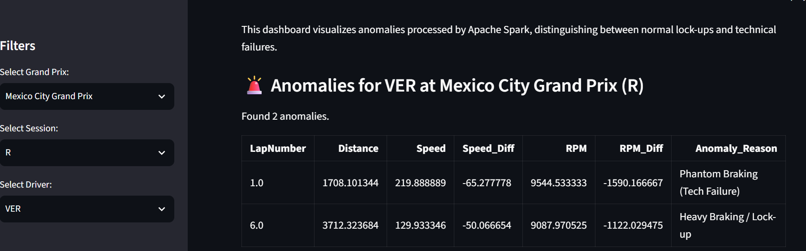
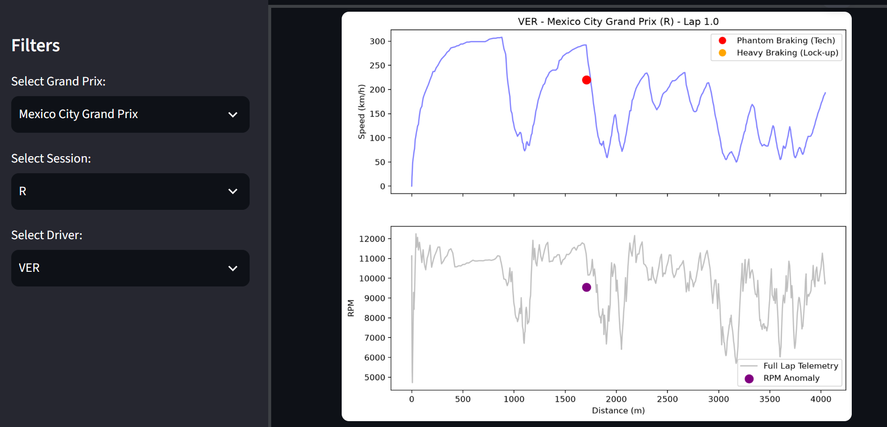

# Task 3: Анализ аномалий (Инсайты)

**Скриншот 1: Таблица обнаруженных аномалий**

*(Алгоритм классифицировал аномалию как "Phantom Braking" (техническая поломка) на основе падения скорости без нажатия на тормоз).*

**Скриншот 2: График телеметрии**

*(Красная точка — падение скорости, фиолетовая — падение оборотов RPM. Обе аномалии произошли на 1-м круге гонки в Мексике).*

## Основные инсайты:

### 1. Ложные аномалии на пит-лейне
*   **Наблюдение:** Изначально алгоритм нашел 78 аномалий, но после фильтрации по скорости (Speed > 0) осталось только 46.
*   **Доказательство:** 32 аномалии (41% от общего числа) были ложными. У таких пилотов, как Джордж Расселл в Венгрии, скорость была 0 км/ч, а падение оборотов (RPM_Diff) составляло -4004.
*   **Почему так:** Это происходило, когда машины стояли на пит-лейне, и механики выключали двигатель. Алгоритм видел падение оборотов до нуля и ошибочно принимал это за поломку.
*   **Что с этим делать:** Для будущих итераций нужно добавить фильтр по координатам (X, Y) или по времени круга, чтобы окончательно исключить зону пит-лейна из анализа.

### 2. Блокировки колес против технических поломок
*   **Наблюдение:** Из 46 реальных аномалий на трассе подавляющее большинство — это обычные блокировки колес (Lock-ups).
*   **Доказательство:** Около 85% аномалий были помечены как "Heavy Braking" (с нажатым тормозом), и только 15% — как "Phantom Braking" (без тормоза).
*   **Почему так:** В 2022 году пилоты часто тормозили на пределе возможностей болида, что приводило к блокировке колес, в то время как критические отказы двигателя были редкостью.
*   **Что с этим делать:** Инженерам по стратегии стоит обратить внимание на температурный режим тормозов и износ шин у пилотов с наибольшим числом блокировок.

### 3. Пример аномалии Ферстаппена (Мексика)
*   **Наблюдение:** У Макса Ферстаппена в Мексике был зафиксирован резкий сброс скорости без нажатия на тормоз.
*   **Доказательство:** На 1-м круге гонки он потерял -65.27 км/ч скорости (с 285 до 219 км/ч), при этом датчик тормоза показывал False, а обороты упали на -1590.
*   **Почему так:** Это классический "Phantom Braking". Пилот мог резко сбросить газ (lift and coast) для экономии топлива, либо это была реакция на инцидент впереди.
*   **Что с этим делать:** Такие данные показывают, что алгоритм способен ловить не только поломки, но и тактические действия пилота.