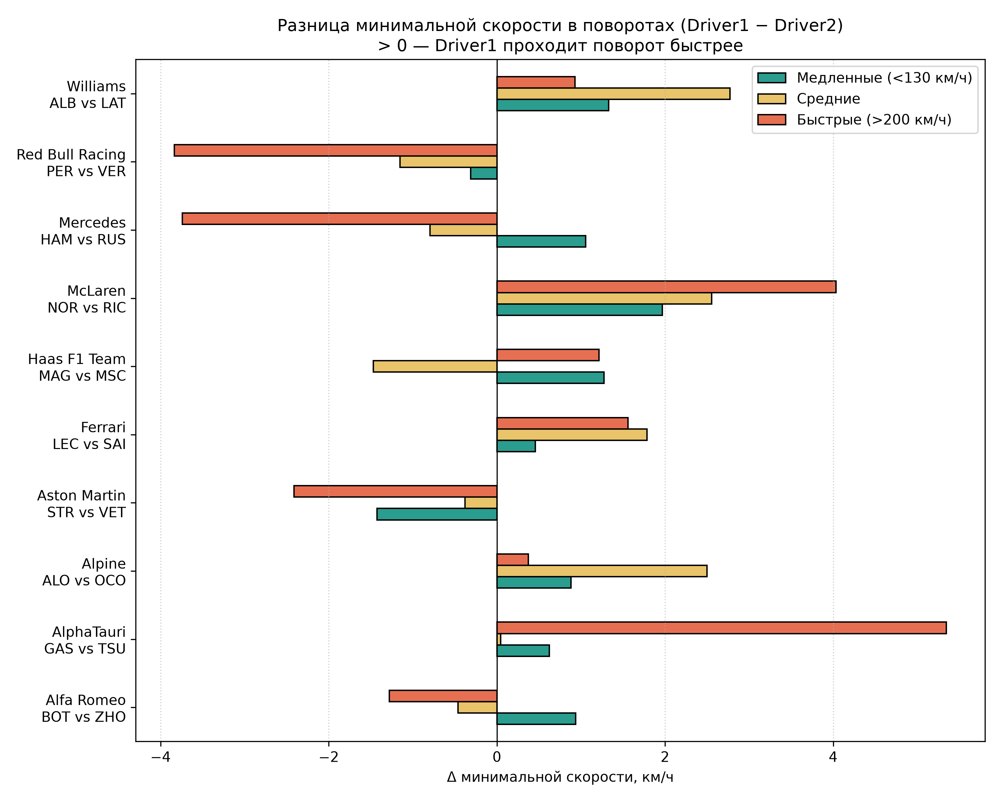
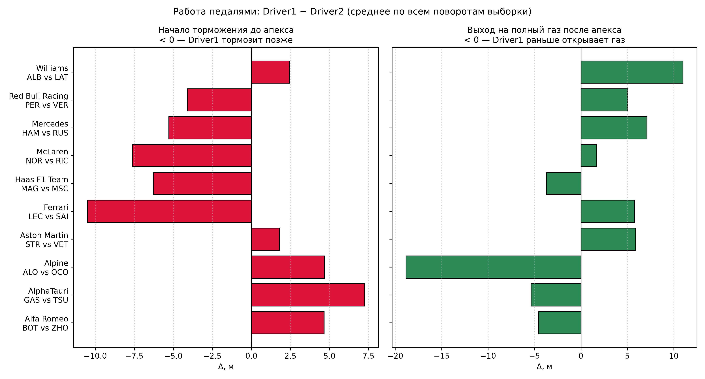
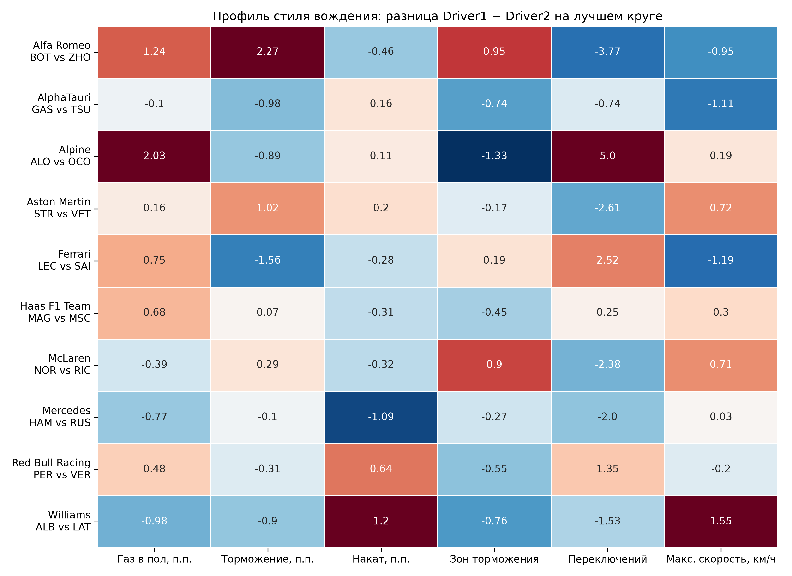
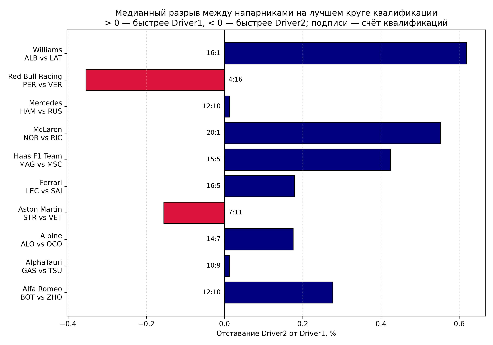

# Инсайты

Инсайт - это не описание графика, а цепочка из четырёх звеньев:

наблюдение → доказательство (цифра) → почему так → что с этим делать

# Задача 1

1. Порядок деградации соответствует физике
+ SOFT 0.123 > MEDIUM 0.069 > HARD 0.056 с/круг.
+ SOFT теряет темп в ~2 раза быстрее MEDIUM и HARD.
Вывод: мягкая резина даёт скорость в начале стинта, но платит износом. Ей выгодны короткие стинты.

2. Падение скорости согласуется с потерей времени
+ Потеря скорости: SOFT -0.18, MEDIUM -0.02, HARD -0.01 км/ч за круг.
+ Оценка: 0.123 с на круге ~90 с - это ~0.14%, при ~200 км/ч получается ~0.27 км/ч. Порядок величины тот же.
Вывод: две независимые метрики подтверждают друг друга, значит расчёт деградации можно считать адекватным.

3. SOFT - самый непредсказуемый состав
+ На boxplot у SOFT самый широкий ящик и усы: от -0.06 до 0.34 с/круг.
+ HARD компактный: почти все значения в диапазоне 0.03-0.09.
Вывод: у SOFT результат сильнее зависит от стиля пилотирования, трафика и трассы, поэтому им рискованнее планировать стратегию.

4. Один и тот же состав на одной гонке ведёт себя по-разному
+ Bahrain, SOFT, первый стинт: ALB 0.288 против BOT 0.061 с/круг.
Вывод: деградация зависит не только от резины, но и от пилота, трафика и трактовки стинта. Это хороший задел для сравнения пилотов.

5. Трассы нельзя сравнивать на одном графике
+ На графике времени круга три кластера: ~100-105 (Bahrain), ~85-90 (Monza), ~80-85 (Monaco).
+ На графике скорости это видно по уровням 240, 195 и 150 км/ч.
Вывод: трасса определяет абсолютный темп намного сильнее, чем резина. Корректно сравнивать только дельты внутри стинта или нормировать по трассе.

# Задача 2

Сравнение лучших корректных кругов квалификации за весь сезон 2022: 22 этапа, 424 пилото-этапа после фильтра 107%, 1 635 сравнений по поворотам. Охват конкретных пар — 17–22 этапа. Источники: [сводка](data_processor/2/reports/task2_pairs_summary.csv), [методика](data_processor/2/README.md), [проверка качества и устойчивости](data_processor/2/VALIDATION.md). Дельты скорости и педалей — Driver1 − Driver2; положительный разрыв квалификации означает преимущество Driver1. Доли дистанции указаны в процентных пунктах; точки педалей — в метрах, а не секундах.

1. Преимущество Леклера сочетается с более поздним торможением, но не с более ранним полным газом
+ Леклер быстрее Сайнса в 16 из 21 сравниваемой квалификации; медианный разрыв — 0.178% относительно времени Леклера.
+ Минимальная скорость Леклера в поворотах выше в среднем на 0.96 км/ч, в средних поворотах — на 1.78 км/ч. Начало торможения в среднем на 10.50 м позже, но полный газ достигается на 5.78 м позже.
Вывод: более быстрый круг может сочетаться с более поздним достижением полного газа. Возможное объяснение — сохранение скорости на входе и внутри поворота. Для проверки нужно разбирать вход и выход вместе с локальной дельтой времени, а не требовать более раннего газа в каждом повороте. Знаки этих трёх различий сохраняются при исключении любого одного этапа.

2. Более позднее торможение само по себе не гарантирует лучший круг
+ Перес начинает тормозить в среднем на 4.10 м позже Ферстаппена, но достигает полного газа на 5.06 м позже; его минимальная скорость ниже на 0.96 км/ч.
+ Ферстаппен быстрее в 16 из 20 сравниваемых квалификаций; медианный разрыв — 0.354% относительно времени Переса.
Вывод: поздняя точка торможения может сопровождаться потерей скорости и задержкой разгона. Для Red Bull полезно проверить баланс входа и выхода по локальным дельтам времени. Агрегаты не доказывают, что именно торможение вызвало проигрыш; различие около одного шага сетки 5 м следует трактовать осторожно. По трём исходным этапам направление разницы торможения было обратным — расширение периода изменило этот вывод.

3. Больше дистанции на полном газу не означает более быстрый круг
+ Норрис быстрее Риккардо в 20 из 21 сравниваемой квалификации; медианный разрыв — 0.552% относительно времени Норриса.
+ Доля дистанции на полном газу у Норриса ниже на 0.39 п.п., а минимальная скорость в поворотах выше на 2.34 км/ч: на 1.97 в медленных, 2.56 в средних и 4.03 в быстрых.
Вывод: доля полного газа скрывает, где именно пилот выигрывает время. Возможное объяснение — более эффективное сохранение скорости в поворотах. В сравнении напарников нужно использовать скорость и локальные дельты времени вместе с педалями. При исключении любого одного этапа разница доли полного газа остаётся отрицательной (от −0.63 до −0.24 п.п.), поэтому наблюдение не определяется одной квалификацией.

4. Профиль преимущества зависит от типа поворота
+ Магнуссен быстрее Шумахера в 15 из 20 сравниваемых квалификаций; медианный разрыв — 0.424% относительно времени Магнуссена.
+ В медленных поворотах его минимальная скорость выше на 1.28 км/ч, в быстрых — на 1.21 км/ч, но в средних ниже на 1.47 км/ч. Общая разница составляет лишь +0.52 км/ч.
Вывод: среднее по всем поворотам сглаживает разнонаправленные различия; более быстрый круг не означает превосходства в каждом типе поворотов. При разборе Haas полезно отдельно изучить средние повороты Шумахера и медленные/быстрые повороты Магнуссена, затем проверить вклад этих участков во время круга. По исходным трём этапам знак разницы в быстрых поворотах был другим — выводы по типам трасс особенно чувствительны к охвату.

5. Близкий итоговый темп может скрывать разные способы прохождения круга
+ Хэмилтон быстрее Расселла в 12 из 22 сравниваемых квалификаций; медианный разрыв — всего 0.013% относительно времени Хэмилтона.
+ Хэмилтон тормозит в среднем на 5.29 м позже, но достигает полного газа на 7.13 м позже. Общая разница минимальной скорости почти нулевая (+0.05 км/ч), при этом в медленных поворотах она +1.06, в средних −0.79, в быстрых −3.74 км/ч.
Вывод: сходный результат может складываться из компенсации выигрышей и потерь на разных участках. Для Mercedes нужно изучать профиль поворотов и локальные дельты времени. Общее преимущество по минимальной скорости приписывать одному пилоту нельзя: при исключении отдельных этапов средняя разница меняет знак (от −0.63 до +0.34 км/ч).

Ограничения: отбираются корректные и не аннулированные круги по флагам FastF1, но условия, шины и сегменты квалификации напарников не выравниваются. Счёт относится к лучшим доступным кругам, а не к официальным стартовым позициям. Повороты определяются автоматически; сетка — 5 м, давление на тормоз не измеряется. Средние по поворотам сильнее взвешивают этапы с большим числом поворотов. Проверки исключением этапов поддерживают наблюдения, но не доказывают причинную связь со стилем пилота.

# Задача 5

1. Телеметрия педалей на первых кругах бесполезна для прогноза
+ Базовые показатели (процент газа/тормоза, ранняя средняя скорость) почти не влияют на работу модели.
+ На графике важности веса PctFullThrottle, PctBraking и AvgEarlySpeed минимальны и стремятся к нулю (< 0.05).
Вывод: на старте гонки пилоты едут в плотном трафике на тяжелых (заправленных) машинах, экономя ресурс, поэтому сырая телеметрия педалей не отражает реальный потенциал болида. Вместо них нужно генерировать тактические фичи (дельта до лидера, езда в зоне DRS).

2. Сила команды важнее стартовой позиции
+ Принадлежность к определенной команде предсказывает итоговый финиш точнее, чем место на стартовой решетке.
+ Вес коэффициента Team_idx (~0.60) на графике важности в полтора раза перевешивает вес GridPosition (~0.40).
Вывод: на дистанции всей гонки гоночный темп топ-команды и гибкая стратегия неизбежно компенсируют плохую квалификацию. В модели стоит использовать исторический "индекс силы команды", а не только полагаться на позицию на старте.

3. Линейная регрессия слепа к форс-мажорам и сходам
+ Модель идеально предсказывает штатные гонки, но выдает гигантские ошибки при авариях или технических сходах.
+ Леклер в Австрии: старт 12, прогноз 8, финиш 8 (ошибка 0). Но Боттас в Катаре: старт 6, прогноз 5, финиш 20 (ошибка 15). Это раздувает общую MAE до ±2.76 позиций.
Вывод: линейный алгоритм предполагает нормальное развитие гонки и не может предвидеть прокол или поломку на 50-м круге. Для реального применения нужен двухэтапный пайплайн: сначала классификатор вероятности схода, затем регрессия для "выживших".

4. Стартовый состав шин — главный управляемый фактор
+ Из всех переменных, которые команда может менять перед стартом, состав резины сильнее всего влияет на прогноз.
+ Признак Compound_idx занимает 4-е место по важности (~0.25), уверенно обходя температуру трассы, воздуха и ранний гоночный темп.
Вывод: выбор жесткости резины на старт жестко диктует всю дальнейшую стратегию (один или два пит-стопа). Чтобы модель лучше понимала контекст, вместо простого индекса шин ей стоит передавать маркер "отклонение стратегии от большинства пелотона".

5. Дождь полностью ломает стандартные паттерны
+ Наличие осадков является абсолютным доминантом в прогнозе, перекрывающим влияние техники.
+ Абсолютный вес фактора Rainfall (~1.35) огромно выделяется на графике и более чем в 2 раза превышает вес команды (Team_idx).
Вывод: в дождевых условиях разница в прижимной силе и мощности нивелируется, а уровень хаоса (машины безопасности, развороты) возрастает. Дождевые гонки нужно прогнозировать иначе: либо обучать под них отдельную модель, либо добавлять фичу "навык пилота в дождь".