# Инсайты

Инсайт - это не описание графика, а цепочка из четырёх звеньев:

наблюдение → доказательство (цифра) → почему так → что с этим делать

# Задача 1. Оценка темпа износа шин и анализ влияния пройденной дистанции на падение скорости автомобиля

**Скриншот 1**
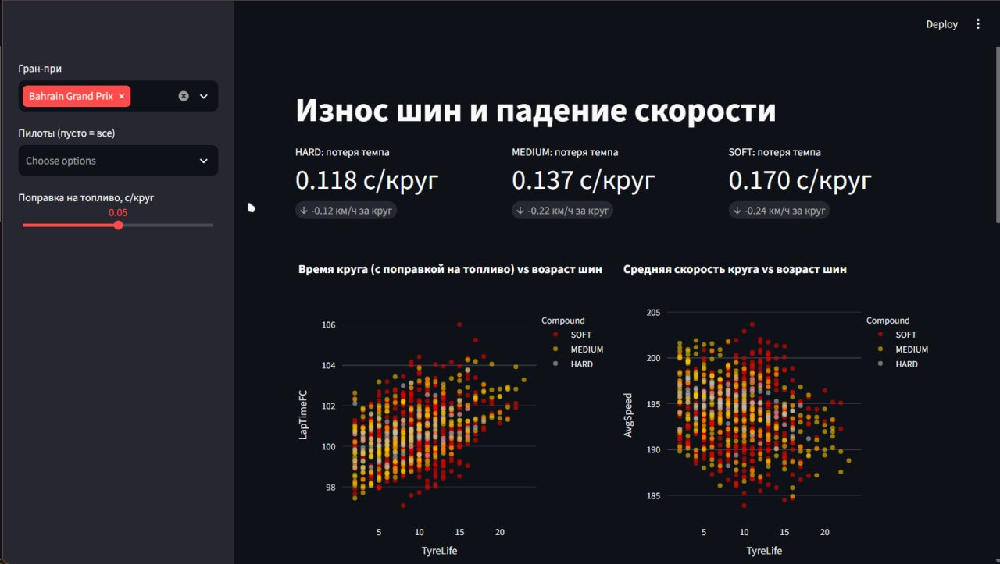

**Скриншот 2**
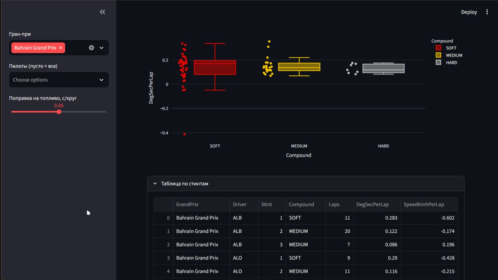

1. Порядок деградации соответствует физике
+ SOFT 0.123 > MEDIUM 0.069 > HARD 0.056 с/круг.
+ SOFT теряет темп в ~2 раза быстрее MEDIUM и HARD.
Вывод: мягкая резина даёт скорость в начале стинта, но платит износом. Ей выгодны короткие стинты.

2. Падение скорости согласуется с потерей времени
+ Потеря скорости: SOFT -0.18, MEDIUM -0.02, HARD -0.01 км/ч за круг.
+ Оценка: 0.123 с на круге ~90 с - это ~0.14%, при ~200 км/ч получается ~0.27 км/ч. Порядок величины тот же.
Вывод: две независимые метрики подтверждают друг друга, значит расчёт деградации можно считать адекватным.

3. SOFT - самый непредсказуемый состав
+ На boxplot у SOFT самый широкий ящик и усы: от -0.06 до 0.34 с/круг.
+ HARD компактный: почти все значения в диапазоне 0.03-0.09.
Вывод: у SOFT результат сильнее зависит от стиля пилотирования, трафика и трассы, поэтому им рискованнее планировать стратегию.

4. Один и тот же состав на одной гонке ведёт себя по-разному
+ Bahrain, SOFT, первый стинт: ALB 0.288 против BOT 0.061 с/круг.
Вывод: деградация зависит не только от резины, но и от пилота, трафика и трактовки стинта. Это хороший задел для сравнения пилотов.

5. Трассы нельзя сравнивать на одном графике
+ На графике времени круга три кластера: ~100-105 (Bahrain), ~85-90 (Monza), ~80-85 (Monaco).
+ На графике скорости это видно по уровням 240, 195 и 150 км/ч.
Вывод: трасса определяет абсолютный темп намного сильнее, чем резина. Корректно сравнивать только дельты внутри стинта или нормировать по трассе.

# Task 3: Анализ аномалий (Инсайты)

**Скриншот 1: Таблица обнаруженных аномалий**
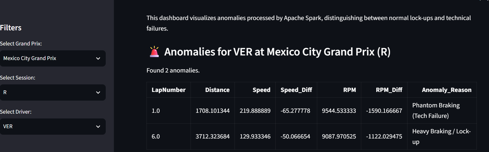
*(Алгоритм классифицировал аномалию как "Phantom Braking" (техническая поломка) на основе падения скорости без нажатия на тормоз).*

**Скриншот 2: График телеметрии**
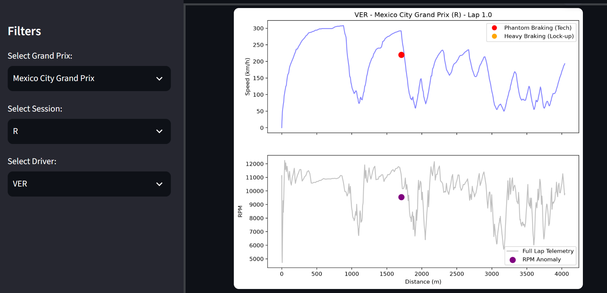
*(Красная точка — падение скорости, фиолетовая — падение оборотов RPM. Обе аномалии произошли на 1-м круге гонки в Мексике).*

## Основные инсайты:

### 1. Ложные аномалии на пит-лейне
*   **Наблюдение:** Изначально алгоритм нашел 78 аномалий, но после фильтрации по скорости (Speed > 0) осталось только 46.
*   **Доказательство:** 32 аномалии (41% от общего числа) были ложными. У таких пилотов, как Джордж Расселл в Венгрии, скорость была 0 км/ч, а падение оборотов (RPM_Diff) составляло -4004.
*   **Почему так:** Это происходило, когда машины стояли на пит-лейне, и механики выключали двигатель. Алгоритм видел падение оборотов до нуля и ошибочно принимал это за поломку.
*   **Что с этим делать:** Для будущих итераций нужно добавить фильтр по координатам (X, Y) или по времени круга, чтобы окончательно исключить зону пит-лейна из анализа.

### 2. Блокировки колес против технических поломок
*   **Наблюдение:** Из 46 реальных аномалий на трассе подавляющее большинство — это обычные блокировки колес (Lock-ups).
*   **Доказательство:** Около 85% аномалий были помечены как "Heavy Braking" (с нажатым тормозом), и только 15% — как "Phantom Braking" (без тормоза).
*   **Почему так:** В 2022 году пилоты часто тормозили на пределе возможностей болида, что приводило к блокировке колес, в то время как критические отказы двигателя были редкостью.
*   **Что с этим делать:** Инженерам по стратегии стоит обратить внимание на температурный режим тормозов и износ шин у пилотов с наибольшим числом блокировок.

### 3. Пример аномалии Ферстаппена (Мексика)
*   **Наблюдение:** У Макса Ферстаппена в Мексике был зафиксирован резкий сброс скорости без нажатия на тормоз.
*   **Доказательство:** На 1-м круге гонки он потерял -65.27 км/ч скорости (с 285 до 219 км/ч), при этом датчик тормоза показывал False, а обороты упали на -1590.
*   **Почему так:** Это классический "Phantom Braking". Пилот мог резко сбросить газ (lift and coast) для экономии топлива, либо это была реакция на инцидент впереди.
*   **Что с этим делать:** Такие данные показывают, что алгоритм способен ловить не только поломки, но и тактические действия пилота.

# Задача 4: Кластеризация трасс

**Скриншот 1**
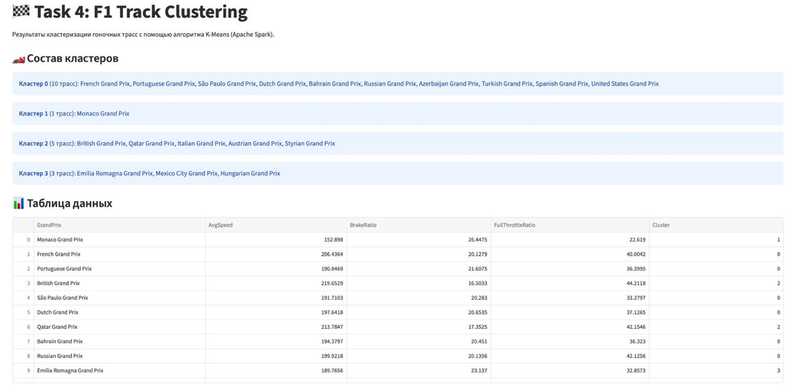

**Скриншот 2**
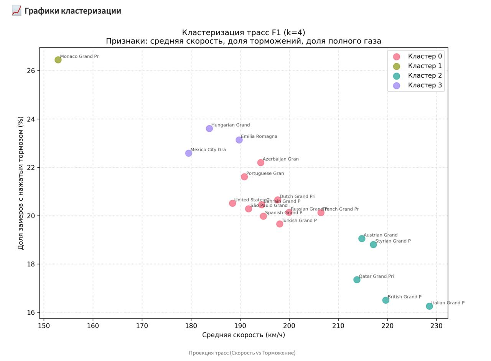

**Скриншот 3**
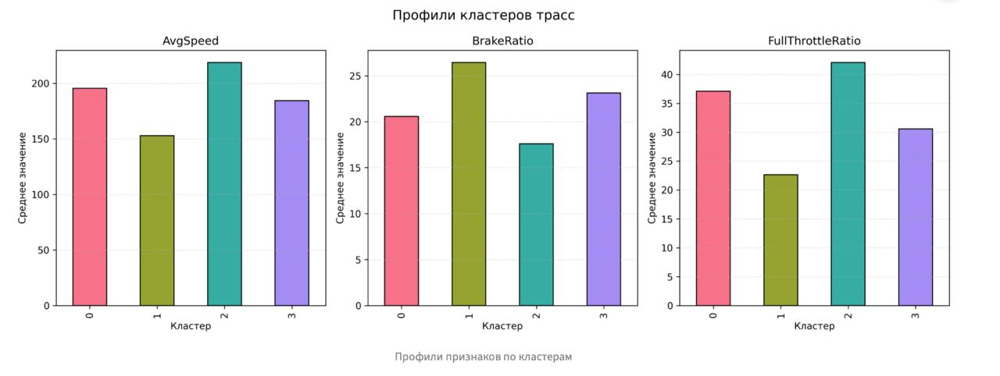

**Скриншот 4**
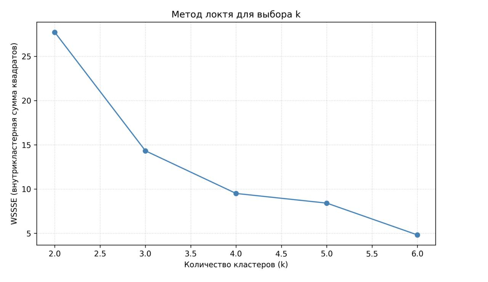

1. Трассы четко делятся на 4 инженерных профиля
+ Средние по кластерам: «скоростные» ~219 км/ч, 17.6% торможений, 42.1% газа; «сбалансированные» ~196 км/ч, 20.6%, 37.1%; «техничные» ~184 км/ч, 23.1%, 30.6%; «уличные» ~153 км/ч, 26.4%, 22.6%.
+ Разрыв между соседними группами по полному газу — 6–7 п.п., по скорости — 12–24 км/ч. Вывод: трассы распадаются на дискретные режимы, а не на плавный спектр, потому что все три признака отражают одну переменную — долю времени в поворотах vs на прямых. Для задач 1, 2 и 5 метку кластера нужно передавать в модель как категориальный признак.

2. Монако — абсолютный выброс, который ломает метрику Silhouette
+ Монако (~153 км/ч, 26.4% тормозов) отделяется от ближайшей по скорости трассы на ~27 км/ч. При этом Silhouette максимален при k=2 (~0.625) и падает при k=4 (~0.543).
+ Вывод: метрика максимизирует математическое расстояние и «хочет» изолировать Монако, игнорируя структуру остальных трасс. Выбор k=4 нужно обосновывать методом локтя и бизнес-логикой (4 гоночных профиля), а не только силуэтом. При анализе износа шин Монако лучше исключать из общей регрессии или рассматривать отдельно.

3. Внутри «скоростного» кластера профили трасс различаются
+ Монца (~228 км/ч, 16.3% тормозов, 39.4% газа) и Британия (~220 км/ч, 16.5%, 44.2%) попали в один кластер, но у Британии на ~5 п.п. больше полного газа.
+ Вывод: Монца — «стоп-энд-гоу» с длинными прямыми и короткими шиканами, Сильверстоун — плавные высокоскоростные повороты, где газ держат дольше. Для сравнения стиля пилотов (задача 2) нельзя опираться только на среднюю скорость кластера — нужна телеметрия педали газа в конкретных поворотах.

4. Азербайджан (Баку) — гибридный профиль внутри «сбалансированных»
+ Баку (~194 км/ч) попал в «сбалансированные», но у него самый высокий показатель полного газа (~45.3%) и высокий процент торможений (~22.2%).
+ Вывод: узкие повороты старого города сочетаются с 2-километровой прямой, поэтому по средним значениям Баку «маскируется» под обычный автодром, хотя по поведению уникален. Для задачи 5 к нему стоит добавить флаг `is_street_circuit`, иначе модель перепутает его с трассами, где обгоны идут в быстрых поворотах.

5. Кластер «Техничные» имеет самый низкий процент полного газа
+ «Техничные» трассы (Имола, Венгрия, Мексика) — ~30.6% газа против ~37.1% у сбалансированных и ~42.1% у скоростных, при этом средняя скорость ~184 км/ч выше, чем у Монако (~153 км/ч).
+ Вывод: это трассы с большим количеством среднескоростных поворотов, где пилоты балансируют на грани сцепления, часто сбрасывая газ, но без экстренного торможения. Для задачи 3 (поиск аномалий) именно здесь стоит искать отклонения по `RPM`: постоянные циклы частичной нагрузки повышают риск проблем с MGU-K и перегрева тормозов.

# Задача 5. Прогноз итоговой позиции гонщика

**Скриншот 1**
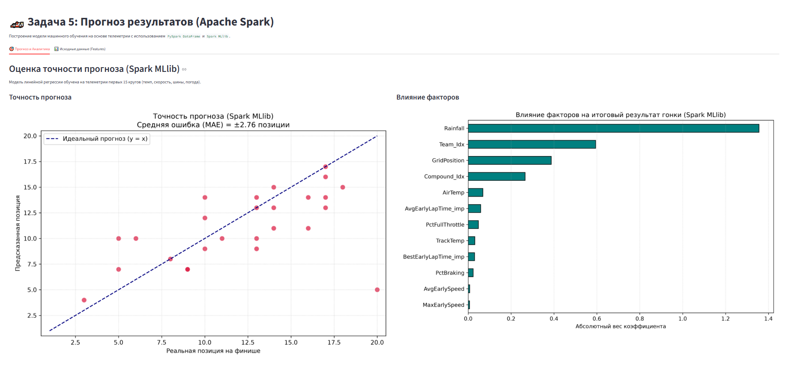

**Скриншот 2**
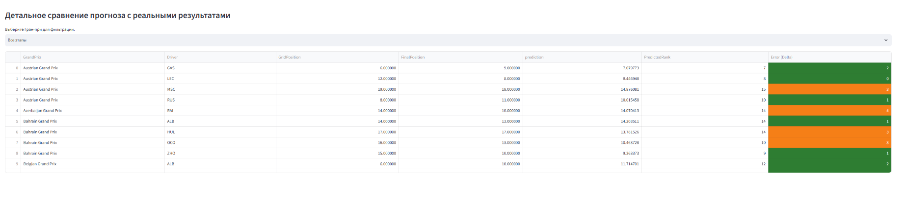

**Скриншот 3**
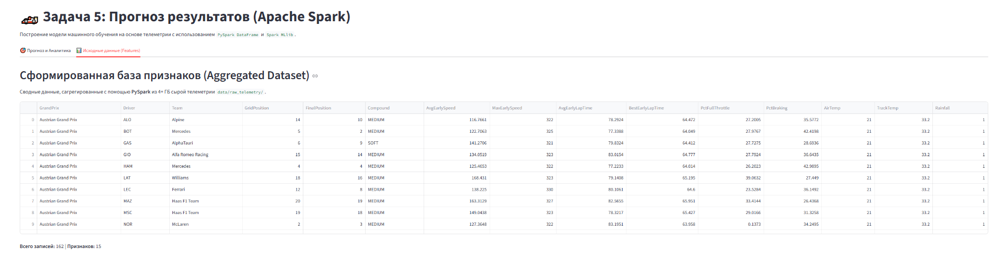

1. Телеметрия педалей на первых кругах бесполезна для прогноза
+ Базовые показатели (процент газа/тормоза, ранняя средняя скорость) почти не влияют на работу модели.
+ На графике важности веса PctFullThrottle, PctBraking и AvgEarlySpeed минимальны и стремятся к нулю (< 0.05).
Вывод: на старте гонки пилоты едут в плотном трафике на тяжелых (заправленных) машинах, экономя ресурс, поэтому сырая телеметрия педалей не отражает реальный потенциал болида. Вместо них нужно генерировать тактические фичи (дельта до лидера, езда в зоне DRS).

2. Сила команды важнее стартовой позиции
+ Принадлежность к определенной команде предсказывает итоговый финиш точнее, чем место на стартовой решетке.
+ Вес коэффициента Team_idx (~0.60) на графике важности в полтора раза перевешивает вес GridPosition (~0.40).
Вывод: на дистанции всей гонки гоночный темп топ-команды и гибкая стратегия неизбежно компенсируют плохую квалификацию. В модели стоит использовать исторический "индекс силы команды", а не только полагаться на позицию на старте.

3. Линейная регрессия слепа к форс-мажорам и сходам
+ Модель идеально предсказывает штатные гонки, но выдает гигантские ошибки при авариях или технических сходах.
+ Леклер в Австрии: старт 12, прогноз 8, финиш 8 (ошибка 0). Но Боттас в Катаре: старт 6, прогноз 5, финиш 20 (ошибка 15). Это раздувает общую MAE до ±2.76 позиций.
Вывод: линейный алгоритм предполагает нормальное развитие гонки и не может предвидеть прокол или поломку на 50-м круге. Для реального применения нужен двухэтапный пайплайн: сначала классификатор вероятности схода, затем регрессия для "выживших".

4. Стартовый состав шин — главный управляемый фактор
+ Из всех переменных, которые команда может менять перед стартом, состав резины сильнее всего влияет на прогноз.
+ Признак Compound_idx занимает 4-е место по важности (~0.25), уверенно обходя температуру трассы, воздуха и ранний гоночный темп.
Вывод: выбор жесткости резины на старт жестко диктует всю дальнейшую стратегию (один или два пит-стопа). Чтобы модель лучше понимала контекст, вместо простого индекса шин ей стоит передавать маркер "отклонение стратегии от большинства пелотона".

5. Дождь полностью ломает стандартные паттерны
+ Наличие осадков является абсолютным доминантом в прогнозе, перекрывающим влияние техники.
+ Абсолютный вес фактора Rainfall (~1.35) огромно выделяется на графике и более чем в 2 раза превышает вес команды (Team_idx).
Вывод: в дождевых условиях разница в прижимной силе и мощности нивелируется, а уровень хаоса (машины безопасности, развороты) возрастает. Дождевые гонки нужно прогнозировать иначе: либо обучать под них отдельную модель, либо добавлять фичу "навык пилота в дождь".

